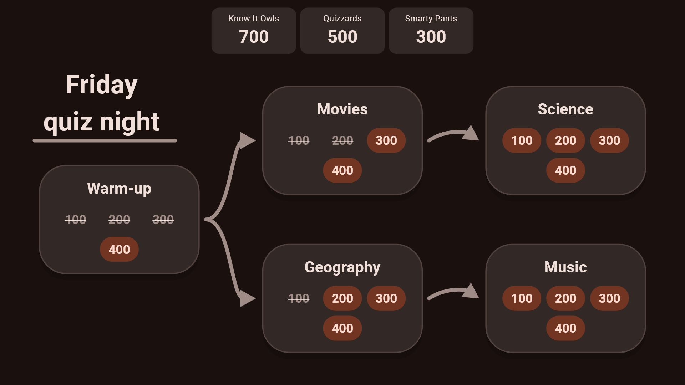
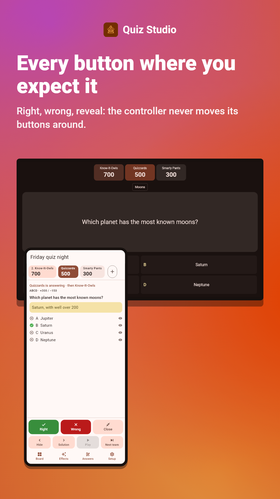
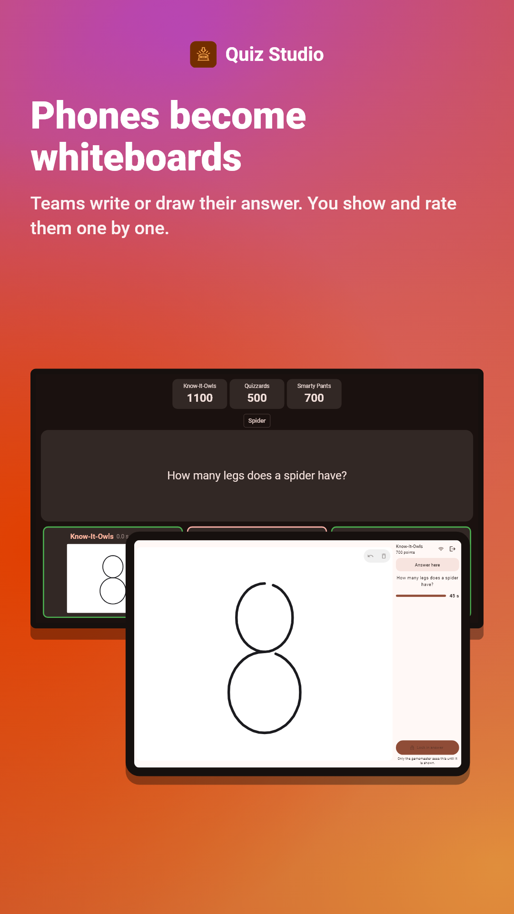
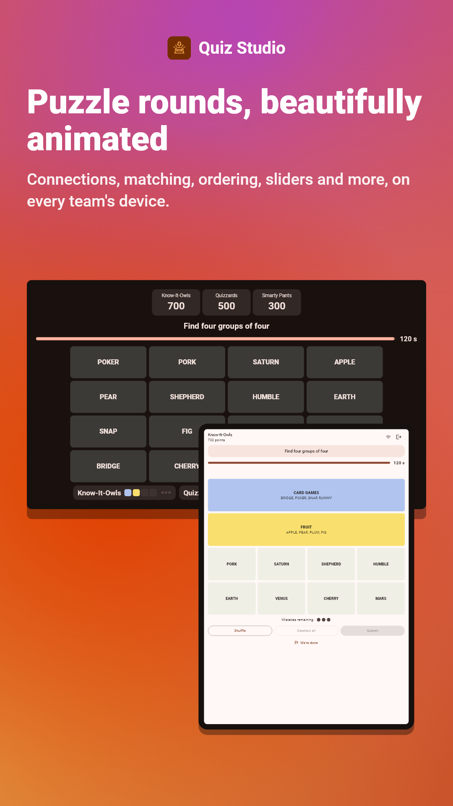
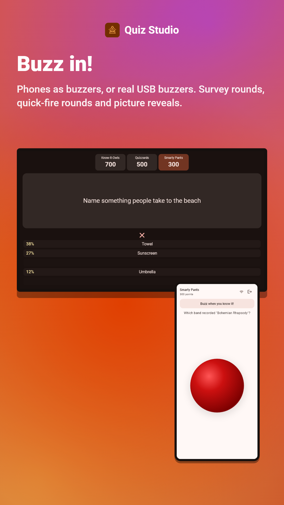
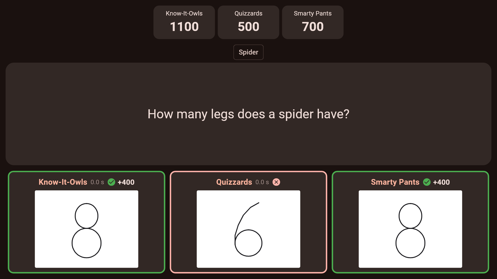
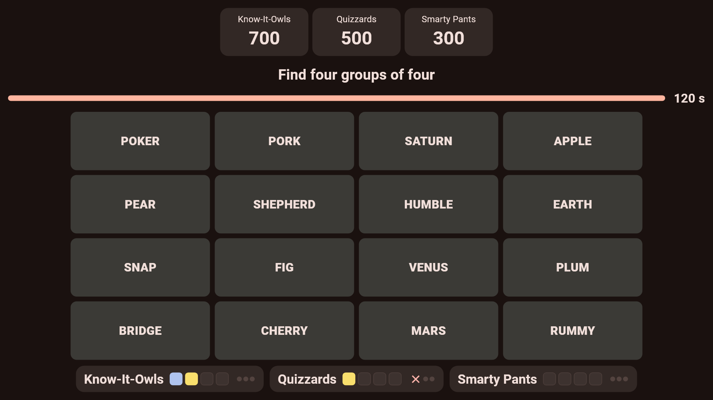
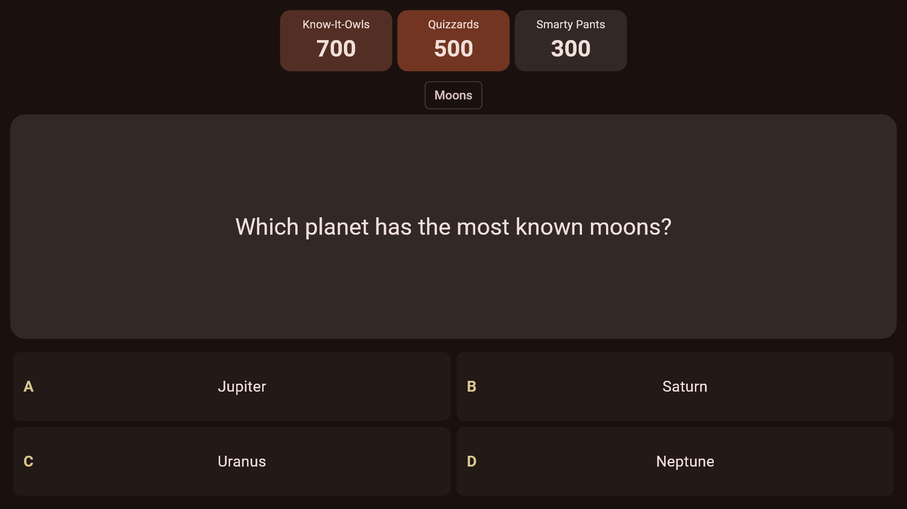
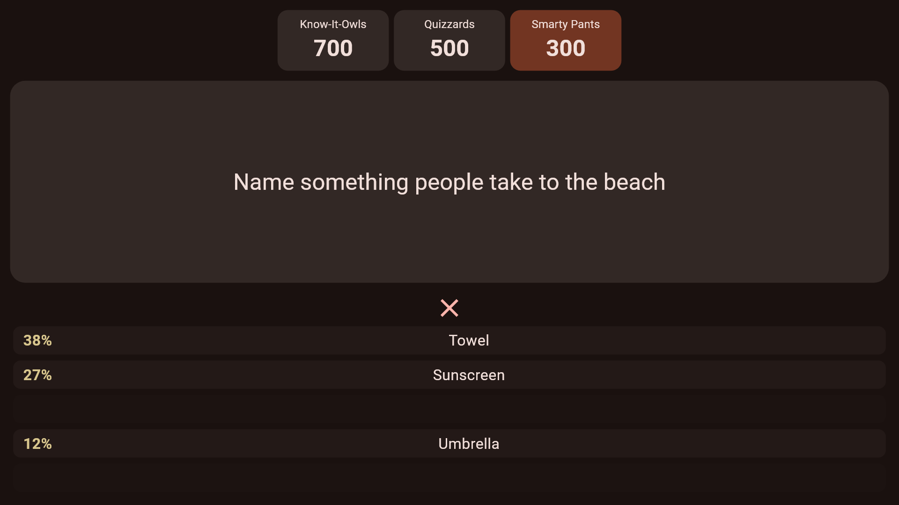

<div align="center">


# Quiz Studio

**Host your own quiz show.**

Build quizzes together with friends, put them on the big screen and run the
whole evening from your phone. Teams buzz in and answer on their own phones.

[](https://flutter.dev)
[](https://firebase.google.com)









</div>

## Features

- **📺 The big screen:** a wheel, a grid or a map of categories with branching paths, team scores, a picture strip and music bars. On Windows the show can open in its own window, full screen on the projector.
- **🎮 A controller that stays put:** Right, Wrong, Reveal and the rest always sit in the same place on the phone, whatever is on screen.
- **🔴 Buzzers:** players scan a code and their phone becomes the team's buzzer. USB buzzer boxes work too, with a connection that heals itself.
- **✍️ Answers on the teams' devices:** whiteboards, text, numbers, sliders, pick one, put in order and match pairs, plus the Connections grid. You show and rate the answers one by one, many of them rate themselves.
- **❓ Question types:** free questions, ABCD, picture and clue reveals, survey rounds (Family Feud style), Connections, matching and quick-fire rounds (Fragenhagel), buzzed or answered on the devices.
- **🎵 Music and effects:** background music, a sound for every moment, team buzzer sounds, confetti, fireworks, cards with pictures or video over the screen.
- **👥 Built together:** invite co-authors with a link, share single categories so nobody spoils the rest.
- **📶 Works on the local network:** phones on the same Wi-Fi talk straight to the big screen, so a show keeps going when the internet drops.
- **🤖 Claude can help:** a local assistant connection lets Claude write and edit your games (off by default).

<table>
  <tr>
    <td></td>
    <td></td>
  </tr>
  <tr>
    <td></td>
    <td></td>
  </tr>
</table>

## How a show works

1. **Write the game** in the editor: boards, categories and questions, with pictures, sounds and cards.
2. **Present** it on the computer or TV that is connected to the projector.
3. **Control** it from your phone, and let a second person help from theirs.
4. **Teams join** by scanning the code for their team. Their phone is the buzzer and shows every answer screen.

## Development

Flutter app, Dart package `quiz_show`. Windows is the desktop and presenter
platform; Android and iOS are for controllers and teams.

- `lib/game/` is the game logic in plain Dart (no Flutter, no Firebase), with unit tests in `test/game/`.
- `lib/features/` holds the screens: auth, games and editor, session (presenter, controller, boards, LAN), companion screens, player, audio, buzzers, settings and the assistant.
- `firebase/` is a private submodule with the Firestore and Storage rules and their emulator tests.
- `third_party/` has patched copies of the FlutterFire Windows plugins (see its README).

```bash
flutter test
```

UI screenshots for checking changes by eye:

```bash
flutter test tool/screenshot_test.dart --update-goldens
```

Store images, the website screenshots and the ones in this README:

```bash
flutter test tool/store_screenshots_test.dart --update-goldens
```

They end up in `screenshots/<store>/` at the exact size each store asks for,
and in `docs/images/`. The texts for the store listings are in
[`screenshots/LISTINGS.md`](screenshots/LISTINGS.md).

## Links

[Website](https://equirinya.github.io/quiz_studio/) ·
[Privacy](https://equirinya.github.io/quiz_studio/privacy.html) ·
[Terms](https://equirinya.github.io/quiz_studio/terms.html) ·
[Sound credits](assets/sounds/CREDITS.md) ·
[Support](mailto:equirinya@gmail.com?subject=Quiz%20Studio%20Support%20Question)
